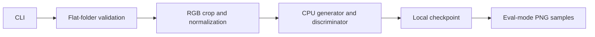

# Local DCGAN baseline

A local 64x64 RGB image-generation baseline extracted from the original Colab notebook. It trains a DCGAN from scratch on a flat folder of PNG/JPEG files. It does not include pretrained weights or download data.


## What works

- Decodes every top-level PNG/JPEG before training, converts to RGB, center-crops/resizes to 64x64, and scales to [-1, 1]. Nested folders are not searched.
- Explicit CPU training, bounded by epochs and a total step cap, with local tensor checkpoint save/load and PNG sampling.
- Sampling uses eval mode, leaves BatchNorm buffers unchanged, and restores the original mode.
- Tests run on synthetic images with small networks, without external requests. Both adversaries' weights are checked for actual updates.

## Install and demo

Python 3.11 on Linux x86_64 is the locked environment. Other platforms are unverified. Install uv separately, then:

```sh
uv sync --locked --extra dev --extra ml
uv run python scripts/synthetic_demo.py
uv run dcgan check-data --folder synthetic-demo/images
uv run dcgan train synthetic-demo/images synthetic-demo/trained --epochs 1 --batch-size 2 --latent 3 --width 2 --max-steps 1
uv run dcgan sample synthetic-demo/trained/checkpoint.pt synthetic-demo/samples --count 2
uv run python -m local_gan --help
uv run dcgan --help
```

Real check-data output: `{"images": 3, "shape": [3, 64, 64]}`. The training demo performs one real optimizer step for each adversary. Its generated images are noise-like engineering evidence, not a quality demo. Output folders must not already exist; choose a new path for each run. TODO: add a reviewed real-data sample gallery with dataset permission and a documented evaluation protocol.

The base install without `--extra ml` supports image checks but not training/sampling. `.env` is optional and ignored by git. `GAN_IMAGES` supplies the `check-data --folder` option; see `.env.example`. Explicit CLI paths take priority. Never put credentials or datasets in git.

Default training retains the original latent=100, generator width=128, corrected discriminator width=128, Adam learning rate=.0004 and beta1=.5. It uses 30 epochs but stops at 100 total steps by default, an intentional safety cap, not equivalent to the notebook's full run. Set `--max-steps` explicitly to change it. Singleton batch tails are dropped; at least two images and batch-size >=2 are required. Checkpoints include network weights and configuration, not optimizer state, so exact training resume is not provided. Only load trusted local checkpoints: `weights_only=True` restricts pickle loading but does not make hostile files safe against all resource attacks.

## Tests and quality

```sh
uv run pytest --cov=local_gan --cov-report=term-missing
uv run ruff check src tests
uv run ruff format --check src tests
uv run mypy src
uv run pre-commit run --all-files
```

23 tests pass, 99% package coverage. This measures exercised engineering logic, not image quality. Small-width synthetic tests cover GAN updates, shape/range, deterministic checkpoint sampling, corrupt inputs, command errors and unchanged sampling buffers. A separate install without Torch passes 16 tests and explicitly skips three ML checks/modules. Full notebook rerun, real CelebA training, FID, diversity and privacy evaluation are not done.

## Data-only Docker

```sh
docker build --tag dcgan:ci .
docker run --rm dcgan:ci --help
docker run --rm -v "$PWD/synthetic-demo:/data:ro" dcgan:ci check-data --folder /data/images
```

Multi-stage image, non-root runtime, no dev tools or Torch. Training is deliberately excluded. The review branch CI builds and smoke-runs these commands on a standard hosted Linux runner only for non-private repositories. No deployments, model uploads, paid APIs or external training jobs are configured. See [verification](docs/verification.md) for actual local results and remaining checks.

## Structure



`core.py` owns inputs/preprocessing, `model.py` owns network/training/sampling, `cli.py` owns arguments/errors. PyTorch, Pillow, NumPy, Typer and python-dotenv are runtime tools, uv locks dependencies, pytest/Ruff/mypy/pre-commit check development work.

## Original notebook and limits

Notebook fixes are a separate commit: discriminator width now honors `ndf`, sampling no longer updates generator BatchNorm statistics, automatic installs/credentials/downloads are disabled, outputs cleared, and the flat-folder/ImageFolder mismatch fails clearly instead of pretending to work. The packaged flat-folder path replaces ImageFolder. The historical notebook is not a turnkey verified workflow and was not fully rerun.

This is DCGAN, not StyleGAN2. No 50k-image training count, FID score, face quality, identity/privacy safety or useful generalization is established. GAN losses alone are not quality metrics. No train/test split or real-data evaluation exists, and seeds are not a promise of cross-version/hardware bitwise reproducibility. No new license is asserted. Next work: independently sourced permitted images, held-out evaluation and memorization checks, then measured FID/diversity if appropriate. Do not use generated faces to impersonate real people.


## License scope

New project-owned package/engineering files use the owner's MIT default. See LICENSE and LICENSE-SCOPE.md. This is not permission to relicense historical notebooks, third-party code, datasets, models or weights. Their provenance and terms still need review. Earlier verification entries saying no license was added describe the initial pilot, not this follow-up.

## Checked synthetic wiring demo

See [commands, saved output and scope](docs/synthetic-demo.md). This is invented-input execution evidence, not model accuracy or a real-data gallery.
